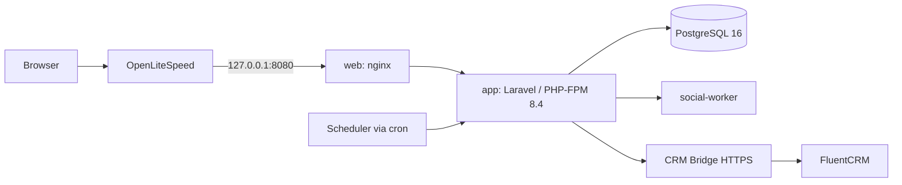
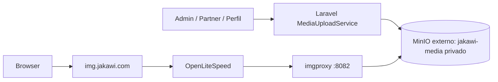

# Arquitectura actual

JAKAWI es un monolito Laravel 13 con frontend React/TypeScript servido mediante Inertia. La aplicación requiere PHP >= 8.4.1 dentro de Docker; PHP del host nunca debe usarse ni inspeccionarse para Laravel, Composer o tests.

## Contenedores y borde

`compose.yaml` define `web`, `app`, `social-worker`, `db` e `imgproxy`. `web` publica solamente `127.0.0.1:8080:80`; OpenLiteSpeed maneja el HTTPS público de `jakawi.com` y hace proxy a ese puerto. `imgproxy` publica `127.0.0.1:8082:8080`; `img.jakawi.com` llega a él mediante OpenLiteSpeed. PostgreSQL no publica un puerto de host. Los datos de producción usan el volumen `jakawi_postgres_data` (con el proyecto Compose por defecto, normalmente `jakawicom_jakawi_postgres_data`).

El build Docker compila Vite una vez y copia el resultado tanto a la imagen `app` como a `web`. Por ello, cualquier cambio de frontend exige reconstruir/recrear ambos servicios en el mismo despliegue: mezclarlos deja manifests o chunks incompatibles.

## Aplicación y frontend consumidor

Las rutas públicas principales son `/`, `/explorar`, partners, lugares, beneficios y experiencias. Las rutas autenticadas incluyen `/mi-jakawi` y `/perfil`; el shell móvil canónico muestra Inicio, Explorar, Mi JAKAWI y Perfil. “Cerca” es una faceta de Explorar, no una navegación primaria.

Laravel entrega props Inertia y React renderiza las superficies consumidoras. La autenticación usa Laravel/Fortify; las áreas Partner y Admin están protegidas por middleware. Los componentes globales no deben asumir que existe un contexto de página Inertia.

## Backend, base de datos y roles

PostgreSQL 16 es la fuente transaccional. El dominio actual gira alrededor de `User`, `UserProfile`, `Partner`, `Location`, `Benefit`, `Membership`, `Redemption`, `Experience`, `ExperienceSession`, `ExperienceReservation` y `AnalyticsEvent`; la definición completa está en [DOMAIN.md](DOMAIN.md).

Un administrador se identifica por `users.is_admin`. El acceso Partner se concede explícitamente por el pivote `partner_user` con roles `owner`, `manager` o `staff`; ser admin no concede ese acceso automáticamente. No existe arquitectura runtime basada en Merchant ni `merchant_id`.

## Media privada

Laravel guarda object keys, no URLs completas. `MediaUrl` firma URLs de imgproxy y `JakawiImage` consume `src`/`srcset`; el navegador nunca recibe credenciales de MinIO. Véase [MEDIA.md](MEDIA.md).

## Aislamiento de tests

`./bin/jakawi-test` usa el proyecto `jakawi-test`, los servicios `app-test`/`db-test`, la base `jakawi_test` y el volumen `jakawi-test_jakawi_test_pgdata`. Antes de ejecutar comandos verifica `APP_ENV=testing`, `DB_HOST=db-test` y `DB_DATABASE=jakawi_test`. Producción no es un destino de pruebas destructivas.

Las ejecuciones de PHPUnit se serializan con un lock local y reconstruyen únicamente `jakawi_test` antes de migrar; una interrupción o una segunda invocación no comparte bootstrap de esquema. La arquitectura prevista para conversión/membresías está en [CONVERSION.md](CONVERSION.md).

La atribución reutiliza el visitor UUID first-party existente como identidad anónima y persiste contactos, referidos, settings y conversiones en PostgreSQL. La política y los límites de privacidad están en [ATTRIBUTION.md](ATTRIBUTION.md).

## Límite de pagos QR

`App\Payments\Qr\Contracts\QrPaymentGateway` es la única dependencia de una futura integración bancaria. La implementación actual es `DisabledQrPaymentGateway`; el contenedor puede resolver `FakeQrPaymentGateway` sólo fuera de producción para pruebas y desarrollo. El gateway crea pagos o informa estado canónico, pero nunca activa Membership ni recibe confirmación desde navegador. La futura aplicación confirmará una compra por una verificación confiable y reutilizará el pipeline de `MembershipPurchaseService`. Detalle y contrato: [PAYMENTS.md](PAYMENTS.md).
## Payout boundary

`RewardPayoutService` realiza la reserva, el pago y el rechazo dentro de transacciones con locks. El pago externo no se automatiza: la plataforma sólo registra su comprobante. `RewardTransaction` sigue siendo la fuente de verdad del ledger; analytics de payout es no bloqueante.

## Dominios y límites actuales

| Dominio | Responsabilidad |
| --- | --- |
| Benefits | Oferta de valor del Partner, disponibilidad, acceso y canje validado |
| Experiences | Actividad, tipo (incluye event), sesiones y destino externo de reserva pública en piloto |
| Unlocks | Demanda colectiva, compromisos, garantías JP, confirmación y fulfillment |
| Challenges | Evidencia, calificación, selección y recompensa diferenciadas |
| Membership | Solicitud, compra/grant, activación y vigencia |
| Cities | Contexto local, estados de ciudad, interés y aplicaciones |
| Discovery | Lectura agregada de oportunidades elegibles por ciudad y afinidad |
| Mi JAKAWI | Historial y valor del usuario, Membership, JP y participaciones |
| JP Ledger | RewardTransaction y holds; JP no es dinero |
| Campaigns | Reglas económicas administradas; no se activan con campaign_key |
| Attribution | Touch explícito y relación referral; mantiene historia |
| Growth Analytics | Eventos canónicos y contexto consultable de funnel; sin dashboard Growth dedicado |
| LandingPresentation | Presentación de adquisición de un subject existente |
| CRM projection | Outbox independiente y contacto/segmentación en FluentCRM |

**PRODUCT DETAIL** es la experiencia normal de navegación/operación. **MARKETING LANDING** es presentación para adquisición, lanzamiento, ads, QR, creators o email. Una landing nunca modifica verdad, economía o reglas del producto.

`/l/{slug}` presenta marketing; `/go/{slug}` sólo redirige a destinos externos configurados; `/d/{slug}` es la ruta nativa del Unlock. LandingPresentation resuelve el destino por viewer y scope sin reemplazar la identidad del producto.

`social-worker` usa `jakawi-app` para las colas `social-interactive,social`; no despacha CRM ni Meta. Ambos outboxes se despachan por scheduler cada minuto. WordPress/FluentCRM viven en CyberPanel, fuera de Docker.

Estado y límites: [CURRENT](CURRENT.md). Uso: [Manual de Funciones](product/MANUAL_DE_FUNCIONES.md). Carga comercial: [Manual de Inventario](operations/MANUAL_DE_INVENTARIO.md). Contratos: [Growth](growth-measurement-v1.md), [CRM](CRM_FOUNDATION_V1.md).

[Decisiones de arquitectura](decisions/README.md) · [Glosario](GLOSSARY.md). Scheduler es cron que invoca app, no un servicio Compose adicional; social-worker procesa colas sociales y CRM se despacha desde scheduler.

## Temas de conversión marketing

MarketingLayout establece temas frontend explícitos `dark-conversion` / `light-conversion`, aislados de la preferencia Product UI. Challenge usa el primero; Benefit, Experience y Unlock el segundo como defaults actuales. Las secciones claras/oscuras establecen pares completos mediante `data-marketing-surface`. El contrato y reglas de contraste están en [Sistema de diseño](DESIGN-SYSTEM.md#marketing-theme-foundation-v1). Marketing Landing Admin V1 persiste los dos temas permitidos; media sigue siendo opcional. Existe un sistema de plantilla única configurable; no hay builder, registry de múltiples templates ni personalización libre de colores.

## Marketing Landing Template V1

`LandingPresentation + Subject → Domain Adapter → OfferPresentationV1 → OfferConversionTemplate → /l/{slug}`.

Una sola plantilla frontend compone oferta, media, facts/valor o precios, CTA, pasos, operaciones, FAQ y cierre. [Contrato](../app/resources/js/components/marketing/offer/presentation.ts) y [renderer](../app/resources/js/components/marketing/offer/OfferConversionTemplate.tsx). Los adapters de [Challenge](../app/resources/js/pages/landing-presentations/adapters/challenge-offer-adapter.tsx), [Experience](../app/resources/js/pages/landing-presentations/adapters/experience-offer-adapter.tsx) y [Benefit](../app/resources/js/pages/landing-presentations/adapters/benefit-offer-adapter.tsx) proyectan los props de sus presenters; no crean otra fuente de verdad. La presentación editorial no redefine economía, reglas, elegibilidad, capacidad ni disponibilidad. Los tratamientos QA permanecen acotados al adapter correspondiente.

El contrato contiene texto y datos derivados; la acción ligada se entrega por separado usando `MarketingAction`. El renderer reutiliza esa misma acción en hero y cierre, sin deducir POST, journey, sesión, grant o membresía desde `kind`/label. Los guards y handlers permanecen en dominio. Growth conserva `landing_view`, `landing_cta_click` y los outcomes `challenge_joined`, `experience_reserved`, `benefit_redeemed` en sus puntos actuales de éxito; la plantilla sólo reutiliza la instrumentación delegada de clicks.

Media opcional: VSL con LandingVideo/JakawiVslPlayer, imagen con JakawiImage, o ausencia sin wrapper. `renderOperationalContent` es un slot frontend obligatorio, no un esquema genérico ni React serializado: participación/reglas, sesiones/reserva y sucursales/requisitos/código pertenecen a sus dominios. Las anotaciones demo y el sticky de Challenge también permanecen locales. Las acciones de dominio siguen en sus rutas; Acquisition Funnel V1 añade resolución de entradas nativas guest según el contrato siguiente.

Marketing Landing Admin V1 extiende la administración compartida existente con una sola clave persistida `OFFER_CONVERSION`; no hay builder, registry ni orden libre de secciones. **Benefit guest/location continuity: RESOLVED** en producción (`60feb98`). La sesión conserva Benefit, intención y `location_id`; un GET canónico retoma el contexto del Benefit tras auth, la ubicación se resuelve antes de membresía/confirmación y sólo el POST crea el canje con los guards de dominio existentes. Desde `8d91303`, el Benefit normal no exige correo verificado; el grant de Challenge conserva verificación.

## Marketing Landing Admin V1

La entrada `/admin/landings` selecciona Benefit, Experience o Challenge y usa el mismo [controller Admin](../app/app/Http/Controllers/AdminLandingPresentationController.php), formulario y rutas subject-scoped existentes. Unlock conserva su renderer, administración y restricciones de disclosure; no tiene adapter Offer Conversion ni aparece en la creación marketing V1.

[LandingPresentation](../app/app/Models/LandingPresentation.php) almacena presentación: enums `template_key`, `marketing_theme`, `media_mode`, `headline_emphasis` contenido en headline, y `final_cta_description`, además de las columnas editoriales/media/atribución existentes. [Migración reversible](../app/database/migrations/2026_10_12_000001_add_offer_presentation_settings.php): mapea los tres dominios a Offer Conversion y sus temas actuales, selecciona VSL sólo cuando existe configuración y conserva todos los campos originales; la entrega original de esa migración no la ejecutó en producción; esa frase es histórica, no acredita el estado aplicado actual de la DB. `editorial_version=0` preserva los tratamientos discovery existentes; pasa a 1 al crear o modificar copy/subject. Cambiar sólo media/tema no resetea el mensaje aprobado.

`default_scope` sigue siendo audiencia activa y exige PUBLISHED. `publish_scope` guarda la intención NONE/GUESTS/ALL de borradores y duplicados; publicar aplica esa intención con el servicio transaccional de defaults existente. Despublicar vuelve a DRAFT/NONE sin perder configuración. Duplicar copia presentación/subject/media e intención, exige nombre y slug únicos nuevos y deja campaign_key explícito/editable; nunca duplica el producto ni publica la copia.

El [editor de presentación](../app/app/Services/LandingPresentationEditor.php) proyecta defaults editables y resumen de verdad de sólo lectura usando presenters/subject actuales. No persiste precios, premios, fechas, elegibilidad, reglas, capacidad ni límites. El renderer recibe la configuración visual y copy validado; operaciones y acciones siguen ligadas por el dominio. No se admiten URL/POST/payload de CTA, HTML, Markdown, CSS, HEX o secciones arbitrarias.

Preview admin-authorized usa el controller público, subject, adapter y renderer reales, con noindex y guards de preview; no registra adquisición/Growth ni ejecuta canjes, reservas, participación o activación. El formulario muestra el preview guardado en iframe a 390/430/1440. `/l/{slug}`, rutas nativas, NONE/GUESTS/ALL, canonical y attribution conservan su comportamiento; campaign_key procede exclusivamente de la configuración guardada y no activa una Campaign económica.

**Continuidad guest de Benefit: RESOLVED** en producción (`60feb98`); autenticación/verificación, membresía y selección `location_id` mantienen el contexto hasta el canje. Admin y plantilla permanecen sin cambios. Las pruebas se ejecutan exclusivamente en el entorno Docker aislado; la entrega original de Admin no incluía migración productiva, push ni deploy.

## Acquisition Funnel V1

**Historial de implementación:** Micro opt-in y Conversion Handoff + Full-page Delivery V1 se documentaron en release `b3c00e` (base anterior `df0476f`). El contrato actual incluye Challenge direct join; ver el [audit de código](architecture/MARKETING_SYSTEM_AUDIT.md) y CURRENT para la última referencia de release. Producción pre-launch tiene tres representantes PUBLISHED / ALL exclusivamente DEMO, sintéticas y no comerciales; no son inventario de lanzamiento.

`Landing → identidad guest (micro opt-in) si hace falta → Activación en página completa si hay elección/requisito → acción explícita de dominio → Delivery en página completa`.

Corrección de handoff LIVE en producción: crear la cuenta es infraestructura, no éxito de conversión. El modal termina tras WhatsApp; autenticados lo omiten. Activación y Resultado usan rutas estables `/l/{slug}/activar` y `/l/{slug}/resultado`; Benefit conserva su confirmación autorizada `/canjes/{id}`. Resultado de reserva JAKAWI exige un outcome propio real y no llama a una reserva pendiente “confirmada”. La reserva externa entrega una página informativa «TODO LISTO PARA RESERVAR» con sesión vigente del subject y enlaces del dominio, sin crear ni afirmar una reserva. Sin nuevas tablas ni configuración de pasos.

El [resolver compartido](../app/app/Services/ProductLandingResolver.php) devuelve el default `PUBLISHED` aplicable al viewer: guest prioriza `GUESTS` sobre `ALL`; autenticados, con o sin membresía activa, usan `ALL`. `NONE` nunca es default automático. Las cuatro rutas GET nativas redirigen a `/l/{slug}` conservando query de atribución; sin default aplicable muestran Product Detail. Landing es la presentación persuasiva principal para cualquier viewer aplicable; Product Detail es el fallback operativo mínimo cuando no existe Landing aplicable. Se mantiene la restricción de un default por subject. `/l/{slug}` directo conserva visibilidad existente, sin `/go`, loops ni Campaign económica; `campaign_key` procede de la presentación guardada.

El CTA guest abre un único modal con nombre → correo → WhatsApp, o login email/contraseña, sobre la misma Landing. [Continuidad](../app/app/Services/PublicJourneyContinuation.php) liga presentación, subject y acción allowlisted en sesión; auth conserva esa Landing y entrega el siguiente paso seguro en `/l/{slug}/activar`. Benefit reutiliza su selector/confirmación, con ubicación después de auth y antes de membresía; Experience conserva reserva externa/interna; Challenge puede participar tras auth únicamente si el submit explícito de adquisición conservó `intended_action=PARTICIPATE`; join no exige verificación, evidencia social y premio sí; Unlock conserva renderer y disclosure. Las acciones autenticadas pasan a Activación o ejecutan el commit explícito si no queda elección; no abren adquisición. Membresía conserva el ID validado de Landing y sucursal/fecha en `journey_context` existente, y su retorno explícito vuelve a su Activación. El retorno de auth puede ejecutar sólo el join Challenge expresamente autorizado por `intended_action=PARTICIPATE`, tras revalidación. El signup genérico, GET y verificación no crean participación; los demás retornos no canjean, reservan, comprometen ni activan membresía. Para marketing normal se recomienda `ALL`; `GUESTS` queda para captación específica. No se modifican registros automáticamente ni se añaden audiencias Free/Paid.

Sólo `acquisition_headline` y `acquisition_supporting_copy` son copy nuevo persistido ([migración aditiva](../app/database/migrations/2026_10_12_000003_add_acquisition_copy_to_landing_presentations.php)); Admin muestra ambos y su fallback por dominio. No existe almacenamiento de configuración general adecuado para este copy. El registro contextual crea y autentica después de WhatsApp, sin pedir contraseña: genera una credencial aleatoria del servidor mediante el hash normal. La contraseña permanente se establece con el broker de reset existente y un correo en la cola, no bloqueante. Email/WhatsApp existente lleva a login/recuperación, nunca autentica por conocimiento de identidad. El registro genérico sigue activo como fallback y usa el mismo creador sin contraseña introducida por el usuario; el correo SecureAccountAccess se encola sólo cuando existe continuación de Landing. V3 conserva composición visual congelada.

Delivery usa verdad de dominio: Benefit reutiliza código/QR y añade dirección/condiciones; Experience muestra sesión y estado real (pending no es confirmación); Challenge entrega instrucciones y estado de participación, no el premio. Un componente compartido mínimo presenta la entrega y, después, el acceso permanente para cuentas nuevas. No hay modelo Delivery ni motor de pasos. Challenge verifica en contexto y retorna a la misma Landing; Unlock protege source con estado de dominio, elegibilidad autenticada y participación vigente tras compromiso explícito.

### Delivery V1.1 — LIVE (`f2b488b`)

Join Challenge es explícito y no requiere email verificado. El límite de evidencia social permanece en `ChallengeController::submit`; selección/otorgamiento exige identidad verificada en `ChallengeService::rewardEligible`, además de las reglas de recompensa existentes. El retorno firmado reevalúa sólo una participación propia existente y vuelve a su Delivery. El presenter deriva instrucciones/plataformas/metas/deadline del dominio; el estado visible mapea qualification/selection/grant, sin estados persistidos nuevos. Logro e instrucciones preceden a cuenta/verificación en la página.

Activación existe sólo cuando el dominio exige una elección operativa real (fecha/sesión o sucursal). Challenge actual no exige elección: CTA explícito → join → Delivery. Adquisición conserva `intended_action=PARTICIPATE`, validado al autenticar; registro genérico y GET nunca participan.

## Marketing → Acquisition → Activation → Delivery: realidad auditada

El [audit V1](architecture/MARKETING_SYSTEM_AUDIT.md) es la referencia del código actual, mapas de campos, rutas, reutilización y trabajo pendiente. `Domain → LandingPresentation → PHP presenter → Domain Adapter → OfferPresentationV1 → OfferConversionTemplate → Landing → Acquisition sólo guest → Activation sólo elección real (política parcialmente cumplida fuera de Challenge) → mutación de dominio → Delivery → ecosistema JAKAWI (navegación parcial)`. Unlock conserva presenter/renderer propio. Product Detail es fallback funcional y sus páginas también implementan operaciones; no se deben eliminar.

La adquisición usa AcquisitionProvider: nombre → correo → WhatsApp, login alternativo y contraseña permanente diferida. Admin guarda acquisition_headline/acquisition_supporting_copy y LandingAcquisition los proyecta, pero el modal actual no los consume. La plantilla V3 permanece LIVE + FROZEN; los nombres V1 del contrato/Admin no son templates alternativos. Welcome Courtesy: FUTURE / OFF / NOT IMPLEMENTED.

Challenge actual no tiene elección previa: final opt-in explícito o CTA autenticado → join → Delivery. El JSX ENTRA AL RETO aún existe en conversion.tsx, pero activar redirige y resultado exige participación propia. Benefit/Experience/Unlock conservan continuaciones que pueden aparecer incluso sin varias opciones. Delivery comparte contenido mínimo y cuenta secundaria; Benefit hereda ConsumerLayout con navegación, mientras los otros resultados tienen logo sin enlace y carecen de footer/navegación al ecosistema.

**Verification Continuity V1 LIVE (`715af599`, desde base real `7cdc8c1`):** Benefit normal no exige verificación en intent/start ni en Delivery propia `/canjes/{public_id}`; ownership, expiración, autorización de partner/PIN y grant de Challenge conservan sus guards. Experience interno conserva la frontera declarada de identidad verificada antes de crear una reserva de asistentes con aprobación del partner; el intento muestra «CONFIRMA TU CORREO PARA RESERVAR» dentro de la misma Activación. Retiene sesión vigente del subject y vuelve allí tras prueba firmada; reservar requiere otro POST explícito. Experience externo entrega sesión/dirección/instrucciones/enlace sin verificación ni reserva local. Challenge no cambia: join sin verificación; evidencia social y selección/otorgamiento sensible con verificación; retorno a Delivery propia. Unlock conserva verificación en interest/commit/cancel/confirm por compromiso/capacidad/JP, con retorno a la misma Activación y estado; no auto-commit, gasto JP ni reveal. Disclosure sigue protegido por estado, elegibilidad y participación propia vigente.

La validación detectó que `User` no implementa `MustVerifyEmail`, por lo que la declaración genérica `verified` no era efectiva para usuarios autenticados. `EnsureContextualActionVerified` comprueba `hasVerifiedEmail()` explícitamente sólo en las mutaciones indicadas de Experience/Unlock; no cambia globalmente el modelo ni otras rutas. Usa `PublicJourneyContinuation`, presentación publicada del subject y sesión validada; no acepta destinos arbitrarios ni reejecuta POST al verificar. Verificación genérica permanece como fallback; SecureAccountAccess sigue separado y secundario. Welcome Courtesy: **FUTURE / OFF**. Las referencias antiguas a migraciones/releases describen entregas históricas y no prueban el estado productivo actual.

## Modo público de pre-lanzamiento

**PRELAUNCH MODE V1 LIVE.** `PRELAUNCH_MODE=true`: raíz Coming Soon estática e indexable; recorridos públicos directos disponibles con aviso permanente y `noindex,nofollow`. Admin/preview/auth sin cambios. Default `false` restaura Home/navegación/SEO existentes. Catálogo clean slate, ejemplos reales pendientes; Welcome Courtesy FUTURE / OFF. [Contrato y operación](operations/PRELAUNCH_MODE_V1.md).

## Partner public profile + acquisition V1 — LIVE

Partner public identity reuses `Partner.slug` and `partner_user` assignments. Root `/{slug}` is canonical; `/p/{slug}` and legacy `/partners/{slug}` redirect. Profile/inventory derive from domain data, with no CMS or schema change. Registered application prefixes are reserved on writes/resolution. Anonymous Partner touches persist through visitor/session into downstream new registration, where existing first-referral-touch ownership applies; latest conversion measurement remains independent. Existing login consumes anonymous candidates for measurement only. Authenticated visits never acquire or reassign. Confirmed `membership_purchased` alone invokes the existing configured reward/payout economy. [Full contract](PARTNER-ACQUISITION.md).

Partner Public Profile V2 is the shared conversion/brand template: brand + active inventory + acquisition entry point. `logo_path` is the contained profile image (`partner_logo` imgproxy fit preset); `cover_path` is the responsive hero (`partner_cover`). The first stored description sentence receives headline styling, without new persisted copy. Missing media gets branded presentation fallbacks; zero inventory is compact. Native Offer routes preserve downstream Landing-first resolution, and guest account actions follow inventory/location. No gallery is modeled on Partner, so none is synthesized. No CMS, template engine, schema fields or acquisition changes.
